<meta name="google-site-verification" content="vq4CEq-9DQ1LWwSCuiW0w79paZ55SpvC_0yHuzYvMSY" />

This project is for downloading, archiving and installing the Steam Runtimes on Linux. You can even install the archived runtimes offline.

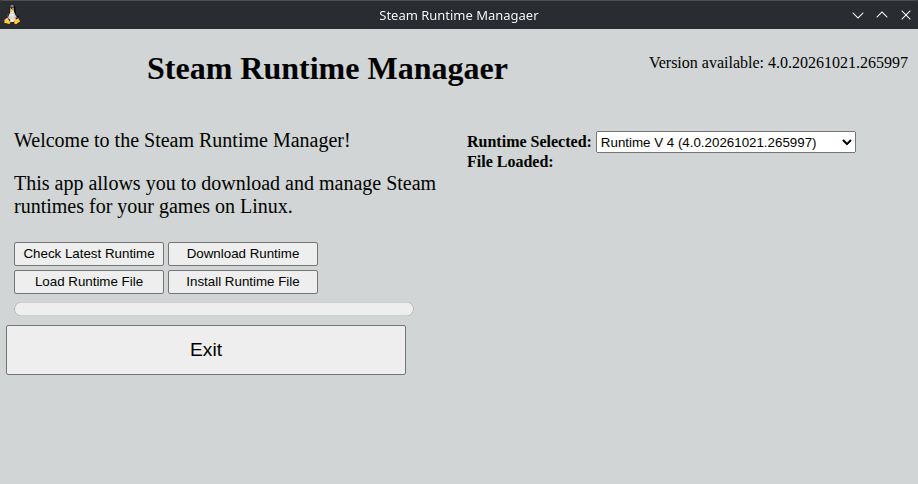

To better understand why I made this program, I recommend checking out this video from YouTuber "Zac of All Tech":

https://www.youtube.com/watch?v=8eLNA2-8fs0

# Why do we need the Steam Runtimes?

In order to play Windows games on Linux, we need to use a runner, such as [Steam Proton](https://github.com/ValveSoftware/Proton), or [Proton GE](https://github.com/GloriousEggroll/proton-ge-custom). This readme will assume that you want to use Proton GE. Certain versions of Proton GE require a certain major version of Steam Runtime. Newer versions &#40;as of 2026&#41; of Prtono GE will require [Steam Runtime V4](https://repo.steampowered.com/steamrt4/images/).

If you are a fan of **Fairy Fencer F Advent Dark Force** like me, you want to specifically use [Proton GE 9-11](https://github.com/GloriousEggroll/proton-ge-custom/releases/tag/GE-Proton9-11), as that version makes the game more playable than playing it on Windows. See [here](https://youtu.be/M1Ou_R1Qr_Y?si=l1XLvOJGlDO9D2BQ) for an extended look at the game with Proton GE 9-11. 

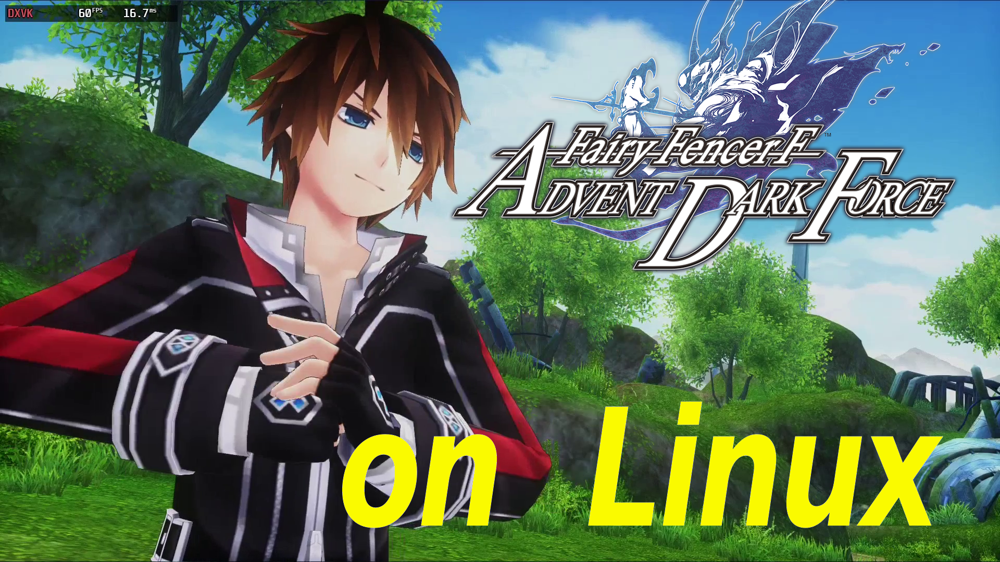

See here for how to make the game playable on [GOG](https://youtu.be/5HwC8cMpVfM?si=CbS1xuz1oVCIwtyz) and [Steam](https://youtu.be/uoPcn9JgrjY?si=YKolwtUoGd7_448h). Proton GE 9-11 requires [Steam Runtime V3 &#40;Sniper&#41;](https://repo.steampowered.com/steamrt3/images/).

# How to use the Steam Runtime Manager

After you download the appImage file assets portion of this link [here](https://github.com/Coates087/SteamRuntimeManager/releases) and you start up the app, you will get screen:

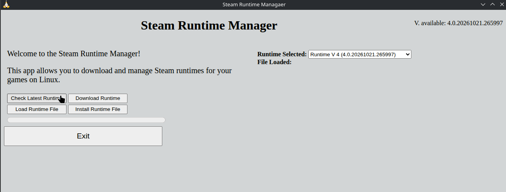

Unless you are offline, the app will immediately check for Runtime updates from Steam's repo. You can see the repo [here](https://repo.steampowered.com/).

Currently, these are the links you would care about for looking at the major version of the Steam Runtime for Linux:
- [Steam Runtime V1 &#40;Scout&#41;](https://repo.steampowered.com/steamrt1/images/)
- [Steam Runtime V2 &#40;Soldier&#41;](https://repo.steampowered.com/steamrt2/images/)
- [Steam Runtime V3 &#40;Sniper&#41;](https://repo.steampowered.com/steamrt3/images/)
- [Steam Runtime V4](https://repo.steampowered.com/steamrt4/images/)

After checking for the latest runtimes, you can click on the the **Runtime Selected** dropdown to select the Steam Runtime you want to download.

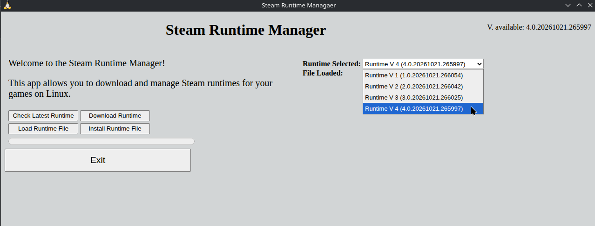

For now, we'll select **Runtime V 4**.

To download the selected runtime, click on the **Download Runtime** button.

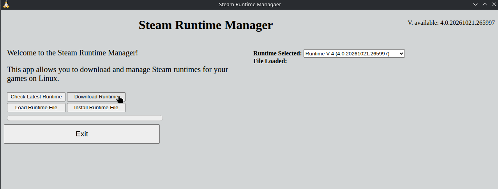

It will then bring up a save file dialog box.

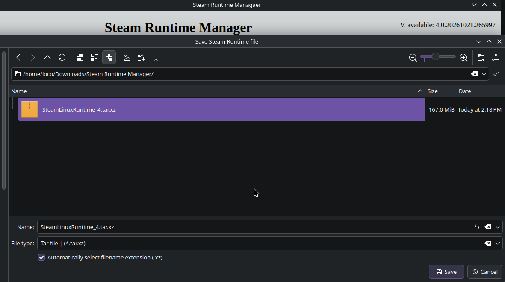

After you chose a destination for your runtime file, the file will start downloading.

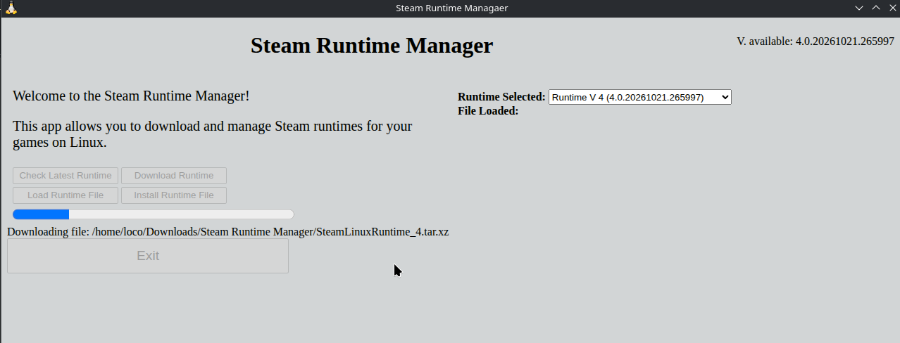

Once that is done, the Manager will ask you if you want to load the file into the Steam Runtime Manager. This will be necessary to install the runtime later.

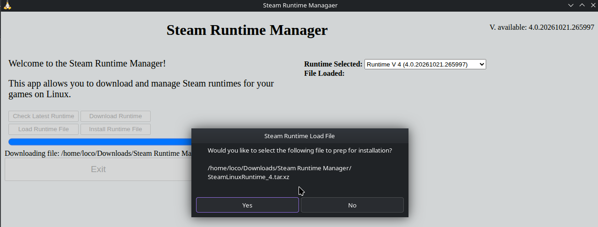

After that, it will ask you if you want to open the directory of where you saved your runtime file as a tarball file &#40;tar.xz&#41;. This is just for if you want to locate the file.

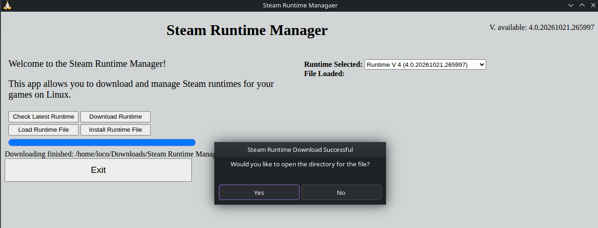

You can also click on the **Open Runtime File Dir** to open the directory for the downloaded file.

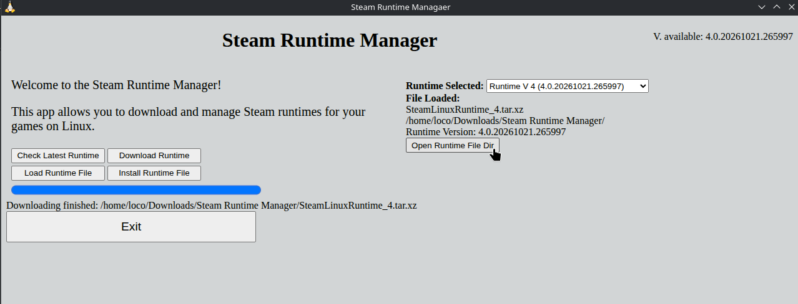

If you wanted to load the Steam Runtime file that you previous downloaded, just click on the **Load Runtime File** button.

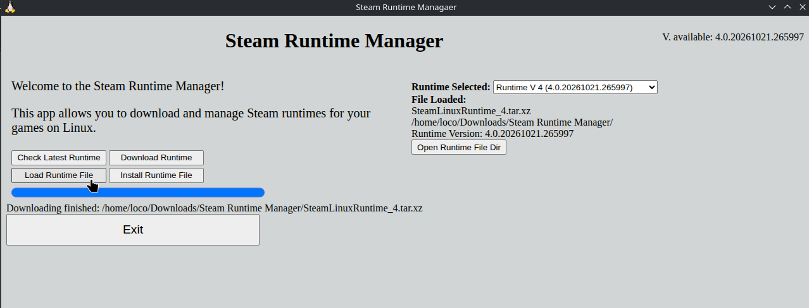

It will bring up the following dialog box:

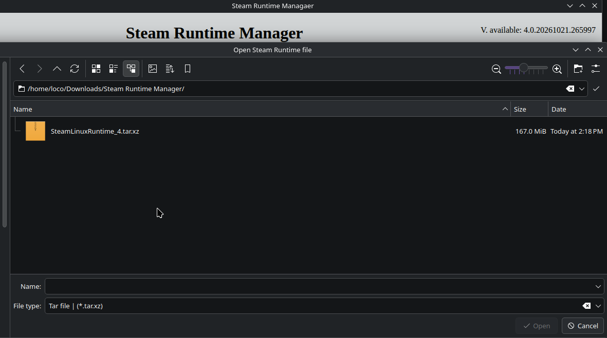

After we're done loading the Steam Runtime file, click on the **Install Runtime File** button

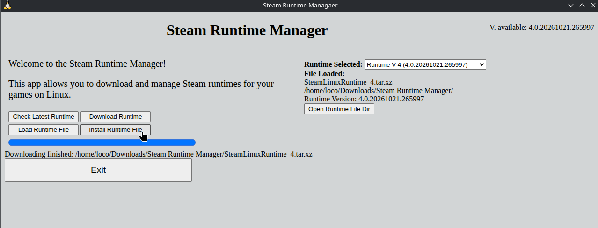

We'll see a loading indicator, letting us know that the runtime is being installed. Note that installation will take a while and requires about 1 GB of storage.

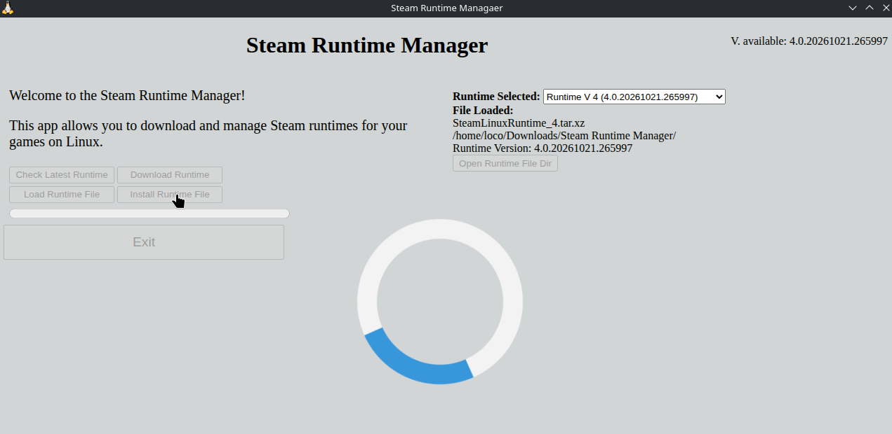

When it is done installing, we'll get the following message below:

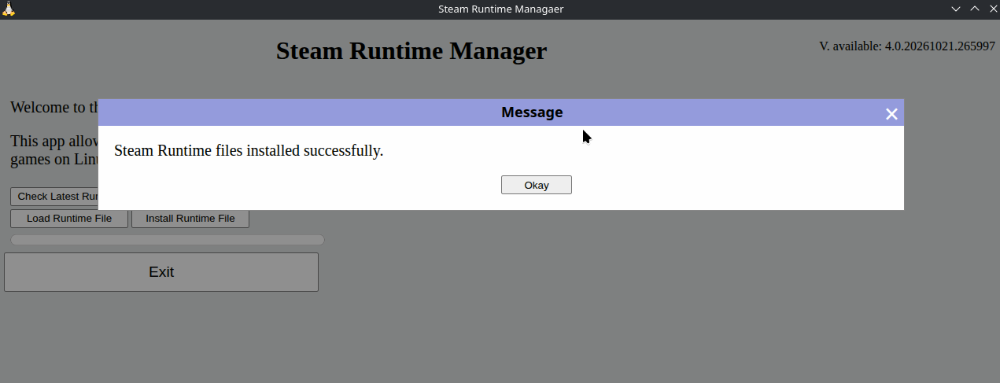

Now you will be able to play your Windows games on Linux via [Heroic Games Launcher](https://heroicgameslauncher.com) or [Lutris](https://lutris.net), when using Proton GE, without an internet connection &#40;in order to download the Steam Runtime files&#41;.

The Steam Runtime files install in the directory below:

> ~/.local/share/umu

Unlike with the **Check Latest Runtime** and **Download Runtime** buttons, The **Load Runtime File** and the **Install Runtime File** buttons do not require an internet connection &#40;since that's kind of the point of this app&#41;.
